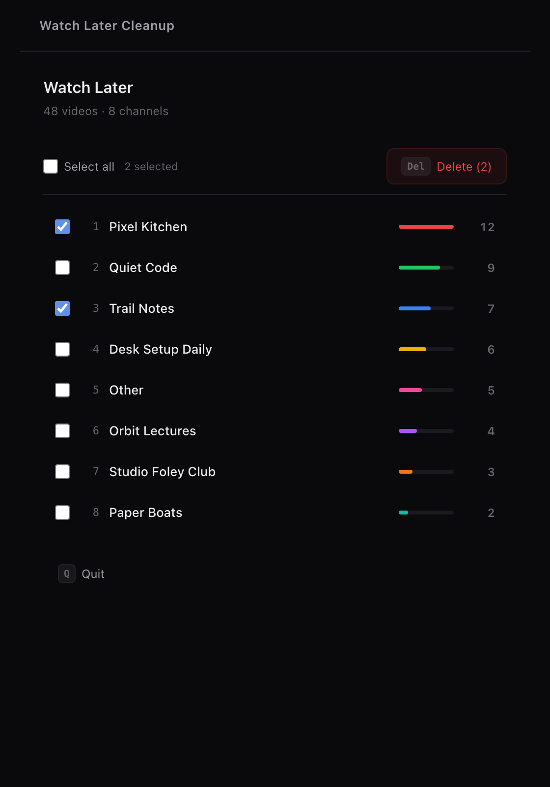
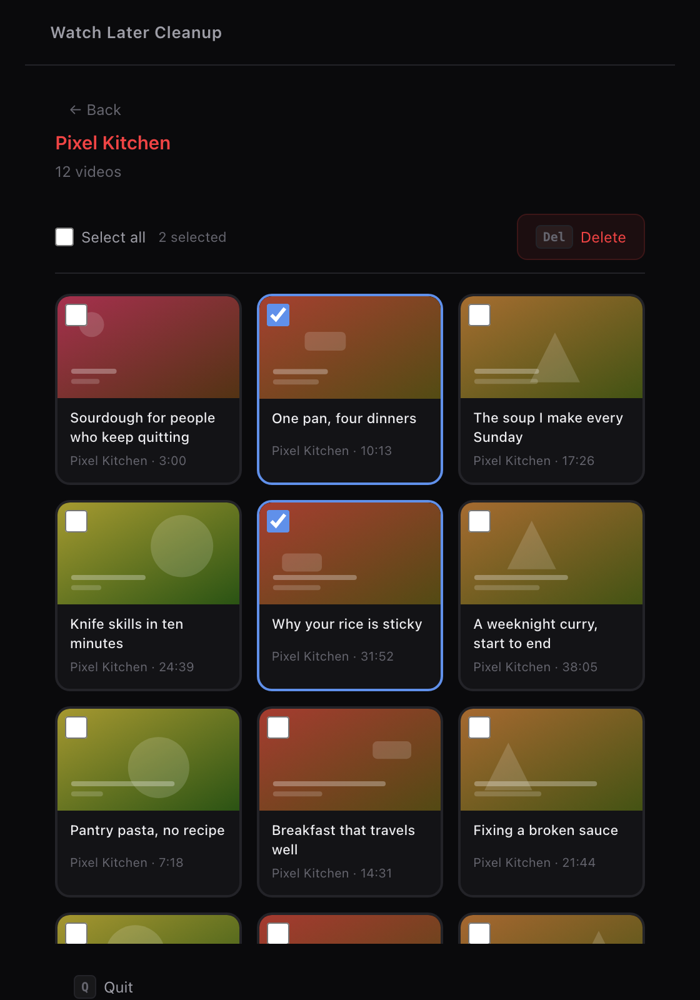

# Watch Later Cleanup

A Chrome extension that sorts your YouTube Watch Later playlist by channel, so you can clear hundreds of old videos in a few minutes instead of one at a time.

<p>
  
  
</p>

*Both screenshots show made-up channels and videos, not a real playlist.*

## What it does

Watch Later has no way to sort or bulk-delete by channel. This extension scans the whole playlist, groups the videos by channel, and lets you:

- **See which channels fill your list.** Each channel shows a count and a bar.
- **Delete a whole channel at once.** Tick the channels you want gone, then press Delete.
- **Pick videos by hand.** Open a channel to see thumbnails, tick videos, and delete them in one step.
- **Review one video at a time.** Step through a channel with the arrow keys. Keep or remove each video, or preview it in place.

Channels with only one video go into an **Other** group.

## Install

You load it as an unpacked extension. It is not on the Chrome Web Store.

You need [Node.js](https://nodejs.org) and Chrome.

1. Build it:
   ```bash
   cd extension
   npm install
   npm run build
   ```
2. Open `chrome://extensions` and turn on **Developer mode** (top right).
3. Click **Load unpacked** and pick the `extension/dist` folder.

## Use it

1. Sign in to YouTube in Chrome.
2. Click the extension's icon in the toolbar. A new tab opens and scans your playlist. If no YouTube tab is open, the extension opens one in the background and closes it when done.
3. Pick channels or videos, then press **Delete**.

Large lists take a while to scan. Press **Q** to stop a scan.

### Keyboard shortcuts

| View | Key | Action |
| --- | --- | --- |
| Channel list | `1`–`9`, `0` | Open channel 1–10 |
| Channel view | `A` | Select all or none |
| | `Delete` | Remove the selected videos |
| | `B` or `Esc` | Back to the channel list |
| Single video | `←` `→` | Previous or next video |
| | `Delete` | Remove this video |
| | `Tab` | Keep this video and move on |
| | `Enter` | Play or stop the preview |
| | `R` | Remove all remaining videos in this channel |
| | `B` or `Esc` | Back to the channel view |
| Any view | `Q` | Quit |

## Safety

- **It removes videos only from Watch Later.** It does not delete them from YouTube, and it does not touch your other playlists or your history.
- **It asks before bulk deletes.** Deleting channels, deleting selected videos, and "remove all" each show a confirmation. Pressing `Delete` on a single video in the single-video view removes it at once, with no prompt.
- **It sends nothing anywhere but YouTube.** There is no server, no analytics and no account. The code runs in your browser, using your existing YouTube sign-in.
- **There is no undo button.** To get a video back, find it and add it to Watch Later again.

### It may break

The extension uses YouTube's internal page API, not the official YouTube Data API. That means no API key and no quota, but YouTube can change it without notice. If a scan or a delete fails, [open an issue](../../issues) and say what you saw.

## Also in this repo

These two tools are separate from the extension.

### `cleanup_watchlater.py` (macOS only)

The same idea as the extension, but it drives Chrome with AppleScript and serves its page from `localhost:9876`.

1. In Chrome, choose **View → Developer → Allow JavaScript from Apple Events**.
2. Open `https://www.youtube.com/playlist?list=WL` while signed in.
3. Run `python3 cleanup_watchlater.py`.

### `gmail-help/` — Gmail Cleanup

A local web page that groups your inbox by sender so you can trash a sender's mail in one click.

- It connects over IMAP with a Gmail **app password**. You need 2-step verification on, and IMAP turned on in Gmail settings.
- It moves mail to **Trash**. Gmail empties Trash after 30 days, so you can still recover mail until then.
- It saves your address and app password in `gmail-help/.gmail_config.json` on your own machine, in plain text. That file is in `.gitignore`. Never commit it. If you stop using the tool, delete the file and revoke the app password at [myaccount.google.com/apppasswords](https://myaccount.google.com/apppasswords).
- Run it with `./gmail-help/run.sh`. It opens `localhost:9877`.

## How it is built

```
extension/src/
  background.ts   service worker: finds a YouTube tab, scans the playlist, removes videos
  app.ts          the interface: channel list, grid, single-video view
  app.html        page shell
  app.css         Tailwind styles
  types.ts        the messages the two sides send each other
```

The interface and the service worker talk over one `chrome.runtime` port. The service worker runs a script inside the YouTube tab to read the playlist and to remove videos. It removes them 20 at a time with a half-second pause, to stay clear of rate limits.

To change the code:

```bash
cd extension
npm run dev      # rebuilds on every save; reload the extension in chrome://extensions
npm run build    # one-off production build
```

Two settings you may want to change:

- `MIN_GROUP_SIZE` in `app.ts` (default `2`). Set it to `1` to list every channel, with no **Other** group.
- `BATCH_SIZE` and `BATCH_DELAY` in `background.ts`.

## License

[MIT](LICENSE)
